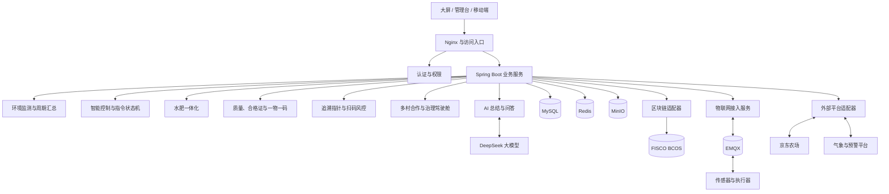
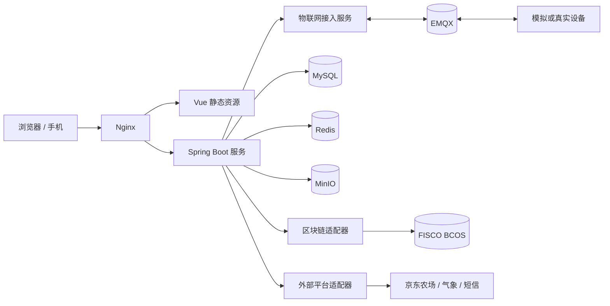

# 智慧温室大棚农产品全链条数字化管理平台技术方案

## 文档说明

本文档根据《毕业设计项目总体设计文档（完善版）》整理，重点说明平台的技术选型、总体架构、模块实现、数据与可信存证、接口、安全、部署、测试和交付标准。

方案面向寒旱区单个设施农业示范基地，以一条完整、可演示、可测试的业务闭环为核心，不扩展到真实支付、跨链交易和复杂人工智能模型训练。

关联设计图：

- [系统功能结构图](../diagrams/01_系统功能结构图.png)
- [核心业务流程图](../diagrams/02_核心业务流程图.png)
- [系统逻辑架构图](../diagrams/03_系统逻辑架构图.png)
- [0层数据流图](../diagrams/04_0层数据流图.png)
- [哈希链与一物一码存证图](../diagrams/05_哈希链与一物一码存证图.png)

## 1. 方案概述

### 1.1 建设背景

寒旱区温室生产对温度、湿度、光照和水肥条件较敏感，传统人工巡检与分散记录方式难以形成连续、可信的业务档案。平台需要同时解决以下问题：

- 环境数据采集不连续，异常发现和调控依赖人工经验。
- 水肥计划、设备控制和执行回执缺少统一记录。
- 作物、农事、检测、合格证、包装和销售信息相互分散。
- 消费者难以验证产品来源、检测结果和追溯链路。
- 多村合作中的土地、股权、合同和分红数据缺少统一口径。
- 普通数据库难以支持基地、村集体、质检机构和消费者之间的多方核验。

平台以物联网采集为数据起点，以电子合格证和一物一码为质量凭证，以联盟链摘要存证为可信支撑，以多村合作和政府驾驶舱为经营与治理出口。

### 1.2 建设目标

1. 实现温室环境数据的周期采集、实时展示、趋势分析和异常预警。
2. 实现通风、湿帘、遮阳、保温、补光、加温和 CO₂ 等设备的策略调控。
3. 实现水肥配方、灌溉计划、阀门泵控制和 EC/pH 监测。
4. 建立作物、农事、检测、合格证和产品批次档案。
5. 实现“一物一码”生成、签名、扫码验证和复制码风险识别。
6. 实现电子合格证 API 验签、结构化备案和链上摘要存证。
7. 实现环境周期根哈希上链、链上查询和链下原始数据核验。
8. 实现一村一图、股权分红、合同议事和经营分析。
9. 为政府监管、京东农场接口和答辩演示提供统一数据出口。

### 1.3 范围与边界

本期范围是一条贯穿生产和销售的主业务链：

`环境采集 -> 根哈希存证 -> 智能调控 -> 水肥执行 -> 采收检测 -> 合格证验签 -> 包装赋码 -> 消费者扫码 -> 合作运营展示`

本期不包含：

- 真实支付结算、资金托管和金融清算。
- 跨链交易、数字资产发行和代币化。
- 面向大规模农场的完整人工智能训练平台。
- 多基地复杂租户隔离和全国性溯源网络。
- 京东农场等外部平台的强制真实接入。

外部平台通过适配器隔离。开发与答辩阶段可使用 Mock 服务，部署时通过配置切换为真实接口。

### 1.4 设计原则

- **链上链下分离**：高频原始数据、图片和大文件留在链下，链上只保存必要摘要和元数据。
- **模块分层**：展示、业务、物联网接入、数据存储、文件服务和区块链执行相互解耦。
- **接口幂等**：采集、控制、验签、上链和扫码接口均使用业务主键或请求编号防止重复处理。
- **双重鉴权**：后端完成权限与状态校验，智能合约再次校验调用账户角色。
- **统一标识**：温室、设备、批次、田块、证书、产品编码和请求编号在所有模块中保持一致。
- **失败可补偿**：链上失败、设备离线或接口超时不得直接标记业务成功，必须保留待处理与补偿状态。
- **证据边界清晰**：区块链证明的是上链后记录未被无痕修改，不替代对数据来源、设备可信性和业务事实的审查。

## 2. 需求约束与验收口径

### 2.1 用户角色

| 角色 | 主要职责 | 权限边界 |
| --- | --- | --- |
| 基地管理员 | 维护基地、温室、设备和人员 | 全局配置、授权、经营数据查看 |
| 温室操作员 | 执行环境调控和水肥计划 | 只能操作授权温室 |
| 农技与巡检员 | 维护作物、农事和巡检档案 | 可录入业务记录，不可生成合格证 |
| 质检与合格证管理员 | 管理检测报告、合格证和溯源码 | 负责验签与备案，不可修改控制策略 |
| 村集体与合作社管理员 | 管理入股、合同和分红 | 仅查看本村和授权项目 |
| 政府监管人员 | 查看示范项目和产业带动指标 | 只读 |
| 消费者 | 查询产品真伪和质量信息 | 仅查看公开溯源信息 |
| 物联网设备与系统服务 | 上报遥测、接收控制、执行存证 | 只能访问授权主题和合约接口 |

### 2.2 核心业务规则

- 一个采集周期生成一个数据序列摘要，重复上报不得生成重复根哈希。
- 同一温室在相同起止时间内只能有一个有效环境周期。
- 链上只保存根哈希、批次、时间戳、设备标识和操作者等必要字段。
- 溯源码必须对应唯一产品批次或包装单元，产品编码重复时禁止再次赋码。
- 消费者扫码验证同时检查签名、链上记录和异常扫码频率。
- 首次扫码和重复扫码分别处理，重复扫码只作为风险线索，不直接判定为假货。
- 控制指令必须包含操作者、目标设备、指令编号和超时时间。
- 合格证必须经过开证系统签发、API 验签和结构化备案后才能进入包装与销售环节。
- 链上交易失败不得把业务状态直接标记为成功。
- 多村股权与分红方案确认后不得直接覆盖，只能通过追加变更记录修正。

### 2.3 功能范围

| 编号 | 功能 | 核心技术处理 | 验收要点 |
| --- | --- | --- | --- |
| FR-01 | 环境监测 | 遥测标准化、周期汇总、摘要与告警 | 数据可查询、可导出、可触发告警 |
| FR-02 | 智能调控 | 策略匹配、指令下发、回执与补偿 | 指令幂等、状态可追踪、失败可补偿 |
| FR-03 | 水肥一体化 | 配方版本、计划执行、阀门泵控制、EC/pH 监测 | 计划按时执行，异常可告警 |
| FR-04 | 农事与作物档案 | 批次关联、农事记录、图片证据 | 记录完整并与批次、田块关联 |
| FR-05 | 检测与合格证 | API 验签、摘要计算、证书备案 | 字段完整、验签成功、摘要可核验 |
| FR-06 | 一物一码溯源 | 编码生成、私钥签名、扫码风险识别 | 签名有效、编码唯一、风险可提示 |
| FR-07 | 区块链存证 | 根哈希、证书摘要、追溯节点和扫码记录上链 | 摘要一致，链上记录可查询 |
| FR-08 | 合作运营 | 一村一图、股权、合同、分红 | 账目和分配记录可追溯 |
| FR-09 | 外部平台接口 | 京东农场、气象和短信预警适配 | 状态可监控、失败可重试 |
| FR-10 | 设备运维 | 在线率、校准、固件和故障工单 | 离线原因和处置过程可查 |

### 2.4 非功能指标

| 类别 | 指标 |
| --- | --- |
| 性能 | 常用查询在测试环境下平均响应时间不超过 2 秒 |
| 实时性 | 环境数据从设备上报到页面可见不超过 10 秒 |
| 可靠性 | 控制与存证接口支持幂等，链上失败保留补偿记录 |
| 可用性 | 大屏、电脑和移动端均可访问，关键页面显示状态与异常原因 |
| 安全性 | 身份认证、RBAC、设备凭证、签名校验、密钥保护和审计日志 |
| 可维护性 | 前后端、物联网、数据、文件和区块链服务分层部署 |

## 3. 总体技术架构

### 3.1 技术选型

| 层级 | 技术 | 用途 |
| --- | --- | --- |
| 前端 | Vue 3、TypeScript、Vite | 管理台、驾驶舱和响应式移动页面 |
| 前端组件与可视化 | Element Plus、ECharts、Pinia、Axios、MQTT.js | 表单、图表、状态管理和实时订阅 |
| 三维数字孪生 | Three.js、OrbitControls | 温室三维场景、设备热点、旋转缩放和图层切换 |
| 后端 | Java 17、Spring Boot 3、Maven | REST API、事务、权限和业务编排 |
| 数据访问 | MyBatis-Plus | 结构化数据持久化与分页查询 |
| 数据库 | MySQL 8 | 用户、设备、批次、质量、合作和统计数据 |
| 缓存 | Redis | 会话、热点配置、幂等锁和实时状态缓存 |
| 文件存储 | MinIO | 图片、检测报告、证书附件和视频 |
| 物联网 | EMQX 或兼容 MQTT Broker | 设备接入、主题订阅和消息路由 |
| 区块链 | FISCO BCOS、Solidity、Java SDK | 联盟链节点、业务合约和交易查询 |
| AI 大模型 | DeepSeek（OpenAI 兼容协议） | AI 总结的框架化归纳与 AI 问答，提示词与数据上下文由后端组装 |
| 运维 | Docker、Nginx、Git | 容器运行、反向代理和版本管理 |
| 接口文档 | OpenAPI/Swagger | REST API 定义、调试和前后端协作 |

区块链版本已按课程实训环境确定：**FISCO BCOS 2.8.0**（四节点单群组，群组编号 1），合约使用 Solidity 0.8.26 编译（EVM 版本 `istanbul`），链上交易由官方 Java SDK 2.9.1 签名发送。选择 2.x 而非 3.x 的原因是实训环境预置的节点与控制台均基于 2.8.0，避免课程作业同时承担链版本迁移成本。

### 3.2 逻辑架构



### 3.3 分层职责

| 层级 | 主要职责 |
| --- | --- |
| 展示交互层 | 页面展示、表单校验、实时数据订阅、控制确认和移动扫码入口 |
| 接入服务层 | REST API、WebSocket、MQTT、文件上传、认证和限流 |
| 业务服务层 | 环境监测、智能调控、水肥执行、质量溯源、合作运营和治理分析 |
| 数据服务层 | MySQL 结构化数据、Redis 缓存、MinIO 文件与时序数据表 |
| 可信服务层 | 哈希计算、签名验签、链上交易、回执查询和失败补偿 |
| 基础设施层 | 物联网终端、MQTT Broker、联盟链节点和外部平台 |

### 3.4 模块职责

| 模块 | 主要职责 | 主要输入 | 主要输出 |
| --- | --- | --- | --- |
| Vue 前端 | 页面、图表、表单和实时状态 | 用户操作、WebSocket/MQTT 消息 | 可视化页面、控制确认 |
| Spring Boot 后端 | 业务规则、权限、事务和接口编排 | HTTP、MQTT、文件 | JSON、设备指令、链上交易 |
| 物联网接入服务 | 设备认证、遥测接收、控制下发和回执 | 传感器数据、控制指令 | 标准遥测、执行状态 |
| MySQL 与 Redis | 业务数据、配置、缓存和回执索引 | 结构化数据 | 条件查询、统计结果 |
| MinIO | 图片、报告、证书附件和视频 | 文件流 | 文件标识和受控访问地址 |
| 区块链适配器 | 参数规范化、签名交易、回执索引和重试 | 业务摘要 | 交易回执、查询结果 |
| 智能合约 | 保存可信摘要、追溯节点和扫码记录 | 签名交易 | 链上记录、事件 |
| 外部平台适配器 | 京东农场、气象和短信接口适配 | 平台业务数据 | 同步状态、外部回执 |
| AI 分析服务 | 组装真实数据上下文、按框架生成总结、多轮问答与会话留痕 | 平台指标、温室环境、预警与问答历史 | 结论文本、来源标注、问答记录 |

### 3.5 项目工程骨架

项目代码采用“中文用途名 + 英文技术名”的双语目录结构。Java 包名、Maven `artifactId`、NPM 包名、API 路径和 Solidity 函数名继续使用英文，确保工具链兼容。

以下目录树覆盖当前 `platform/` 中的全部业务源码、配置和模块说明文件。`node_modules/`、`target/`、`dist/`、链上构建产物和本地运行数据属于生成目录，不在源码骨架中展开。

```text
platform/
├─ 部署配置_deploy/
│  ├─ .env.example
│  ├─ 说明_README.md
│  └─ docker-compose.infra.yml
├─ 后端服务_backend/
│  ├─ 公共模块_greenhouse-common/
│  │  ├─ src/
│  │  │  └─ main/
│  │  │     └─ java/
│  │  │        └─ com/
│  │  │           └─ smartgreenhouse/
│  │  │              └─ common/
│  │  │                 ├─ api/
│  │  │                 │  └─ ApiResponse.java
│  │  │                 └─ error/
│  │  │                    ├─ BusinessException.java
│  │  │                    └─ ErrorCode.java
│  │  ├─ 说明_README.md
│  │  └─ pom.xml
│  ├─ 物联网服务_greenhouse-iot/
│  │  ├─ src/
│  │  │  └─ main/
│  │  │     ├─ java/
│  │  │     │  └─ com/
│  │  │     │     └─ smartgreenhouse/
│  │  │     │        └─ iot/
│  │  │     │           ├─ config/
│  │  │     │           │  └─ MqttProperties.java
│  │  │     │           ├─ mqtt/
│  │  │     │           │  ├─ LoggingMqttGateway.java
│  │  │     │           │  ├─ MqttGateway.java
│  │  │     │           │  └─ PahoMqttGateway.java
│  │  │     │           ├─ telemetry/
│  │  │     │           │  ├─ RestTelemetryForwarder.java
│  │  │     │           │  ├─ TelemetryForwarder.java
│  │  │     │           │  ├─ TelemetryIngestService.java
│  │  │     │           │  └─ TelemetryMessage.java
│  │  │     │           └─ IotApplication.java
│  │  │     └─ resources/
│  │  │        └─ application.yml
│  │  ├─ src/test/java/com/smartgreenhouse/iot/telemetry/
│  │  │  └─ TelemetryIngestServiceTest.java
│  │  ├─ 说明_README.md
│  │  └─ pom.xml
│  ├─ 业务服务_greenhouse-api/
│  │  ├─ src/
│  │  │  ├─ main/
│  │  │  │  ├─ java/
│  │  │  │  │  └─ com/
│  │  │  │  │     └─ smartgreenhouse/
│  │  │  │  │        └─ api/
│  │  │  │  │           ├─ common/
│  │  │  │  │           │  └─ GlobalExceptionHandler.java
│  │  │  │  │           ├─ config/
│  │  │  │  │           │  ├─ ApiAuthenticationEntryPoint.java
│  │  │  │  │           │  ├─ DemoSchedulingConfig.java
│  │  │  │  │           │  ├─ SecurityConfig.java
│  │  │  │  │           │  └─ WebConfig.java
│  │  │  │  │           ├─ integration/
│  │  │  │  │           │  └─ chain/
│  │  │  │  │           │     ├─ ChainGateway.java
│  │  │  │  │           │     ├─ ChainReceipt.java
│  │  │  │  │           │     └─ SimulatedChainGateway.java
│  │  │  │  │           ├─ modules/
│  │  │  │  │           │  ├─ alert/
│  │  │  │  │           │  │  ├─ AlertController.java
│  │  │  │  │           │  │  ├─ AlertMapper.java
│  │  │  │  │           │  │  ├─ AlertService.java
│  │  │  │  │           │  │  └─ AlertView.java
│  │  │  │  │           │  ├─ auth/
│  │  │  │  │           │  │  ├─ AuthController.java
│  │  │  │  │           │  │  ├─ AuthMapper.java
│  │  │  │  │           │  │  ├─ AuthService.java
│  │  │  │  │           │  │  ├─ JwtAuthenticationFilter.java
│  │  │  │  │           │  │  ├─ JwtTokenService.java
│  │  │  │  │           │  │  └─ LoginView.java
│  │  │  │  │           │  ├─ control/
│  │  │  │  │           │  │  ├─ ControlCommandMapper.java
│  │  │  │  │           │  │  ├─ ControlCommandService.java
│  │  │  │  │           │  │  ├─ ControlCommandView.java
│  │  │  │  │           │  │  └─ ControlController.java
│  │  │  │  │           │  ├─ cooperation/
│  │  │  │  │           │  │  ├─ CooperationController.java
│  │  │  │  │           │  │  ├─ CooperationMapper.java
│  │  │  │  │           │  │  ├─ CooperationService.java
│  │  │  │  │           │  │  ├─ CooperationShareView.java
│  │  │  │  │           │  │  ├─ DividendView.java
│  │  │  │  │           │  │  └─ VillageSummary.java
│  │  │  │  │           │  ├─ crop/
│  │  │  │  │           │  │  ├─ CropBatchController.java
│  │  │  │  │           │  │  ├─ CropBatchMapper.java
│  │  │  │  │           │  │  ├─ CropBatchService.java
│  │  │  │  │           │  │  └─ CropBatchView.java
│  │  │  │  │           │  ├─ dashboard/
│  │  │  │  │           │  │  ├─ DashboardController.java
│  │  │  │  │           │  │  ├─ DashboardMapper.java
│  │  │  │  │           │  │  ├─ DashboardService.java
│  │  │  │  │           │  │  └─ GovernmentDashboardView.java
│  │  │  │  │           │  ├─ environment/
│  │  │  │  │           │  │  ├─ EnvironmentController.java
│  │  │  │  │           │  │  ├─ EnvironmentCycleView.java
│  │  │  │  │           │  │  ├─ EnvironmentMapper.java
│  │  │  │  │           │  │  ├─ EnvironmentService.java
│  │  │  │  │           │  │  ├─ EnvironmentSnapshot.java
│  │  │  │  │           │  │  ├─ EnvironmentThresholdController.java
│  │  │  │  │           │  │  ├─ EnvironmentThresholdMapper.java
│  │  │  │  │           │  │  ├─ EnvironmentThresholdService.java
│  │  │  │  │           │  │  ├─ EnvironmentThresholdView.java
│  │  │  │  │           │  │  └─ EnvironmentTrend.java
│  │  │  │  │           │  ├─ greenhouse/
│  │  │  │  │           │  │  ├─ GreenhouseController.java
│  │  │  │  │           │  │  ├─ GreenhouseOverview.java
│  │  │  │  │           │  │  ├─ GreenhouseOverviewMapper.java
│  │  │  │  │           │  │  ├─ GreenhouseOverviewService.java
│  │  │  │  │           │  │  └─ GreenhouseSummary.java
│  │  │  │  │           │  ├─ health/
│  │  │  │  │           │  │  └─ HealthController.java
│  │  │  │  │           │  ├─ proof/
│  │  │  │  │           │  │  ├─ ProofController.java
│  │  │  │  │           │  │  ├─ ProofMapper.java
│  │  │  │  │           │  │  ├─ ProofService.java
│  │  │  │  │           │  │  └─ ProofView.java
│  │  │  │  │           │  ├─ quality/
│  │  │  │  │           │  │  ├─ CertificateManagementService.java
│  │  │  │  │           │  │  ├─ CertificateMapper.java
│  │  │  │  │           │  │  ├─ CertificateController.java
│  │  │  │  │           │  │  ├─ CertificateVerifyMapper.java
│  │  │  │  │           │  │  ├─ CertificateVerifyResult.java
│  │  │  │  │           │  │  ├─ CertificateVerifyService.java
│  │  │  │  │           │  │  ├─ CertificateView.java
│  │  │  │  │           │  │  ├─ QualityReportController.java
│  │  │  │  │           │  │  ├─ QualityReportDownload.java
│  │  │  │  │           │  │  ├─ QualityReportMapper.java
│  │  │  │  │           │  │  ├─ QualityReportService.java
│  │  │  │  │           │  │  └─ QualityReportView.java
│  │  │  │  │           │  ├─ storage/
│  │  │  │  │           │  │  ├─ FileStorageService.java
│  │  │  │  │           │  │  ├─ LocalFileStorageService.java
│  │  │  │  │           │  │  ├─ MinioFileStorageService.java
│  │  │  │  │           │  │  ├─ StoredFile.java
│  │  │  │  │           │  │  └─ StoredFileContent.java
│  │  │  │  │           │  ├─ telemetry/
│  │  │  │  │           │  │  ├─ IotTelemetryController.java
│  │  │  │  │           │  │  ├─ IotTelemetryMapper.java
│  │  │  │  │           │  │  ├─ IotTelemetryService.java
│  │  │  │  │           │  │  └─ IotTelemetryView.java
│  │  │  │  │           │  ├─ trace/
│  │  │  │  │           │  │  ├─ ScanResultView.java
│  │  │  │  │           │  │  ├─ TraceCodeController.java
│  │  │  │  │           │  │  ├─ TraceCodeService.java
│  │  │  │  │           │  │  ├─ TraceCodeView.java
│  │  │  │  │           │  │  ├─ TraceController.java
│  │  │  │  │           │  │  ├─ TraceMapper.java
│  │  │  │  │           │  │  ├─ TracePathView.java
│  │  │  │  │           │  │  ├─ TraceService.java
│  │  │  │  │           │  │  └─ TraceView.java
│  │  │  │  │           │  └─ waterfertilizer/
│  │  │  │  │           │     ├─ WaterFertilizerController.java
│  │  │  │  │           │     ├─ WaterFertilizerMapper.java
│  │  │  │  │           │     ├─ WaterFertilizerPlanView.java
│  │  │  │  │           │     └─ WaterFertilizerService.java
│  │  │  │  │           └─ SmartGreenhouseApiApplication.java
│  │  │  │  └─ resources/
│  │  │  │     ├─ application-demo.yml
│  │  │  │     ├─ application.yml
│  │  │  │     └─ db/
│  │  │  │        └─ migration/
│  │  │  │           ├─ V1__core_business_schema.sql
│  │  │  │           ├─ V2__demo_seed.sql
│  │  │  │           ├─ V3__quality_trace_schema.sql
│  │  │  │           ├─ V4__quality_trace_seed.sql
│  │  │  │           ├─ V5__cooperation_schema.sql
│  │  │  │           ├─ V6__cooperation_seed.sql
│  │  │  │           ├─ V7__certificate_verification_log.sql
│  │  │  │           ├─ V8__quality_report_institution.sql
│  │  │  │           ├─ V9__water_fertilizer_schema.sql
│  │  │  │           ├─ V10__water_fertilizer_seed.sql
│  │  │  │           ├─ V11__auth_seed.sql
│  │  │  │           ├─ V12__iot_telemetry_schema.sql
│  │  │  │           ├─ V13__unify_demo_passwords.sql
│  │  │  │           ├─ V14__device_operating_state.sql
│  │  │  │           ├─ V15__environment_thresholds.sql
│  │  │  │           └─ V16__alert_record.sql
│  │  │  └─ test/
│  │  │     ├─ java/
│  │  │     │  └─ com/
│  │  │     │     └─ smartgreenhouse/
│  │  │     │        └─ api/
│  │  │     │           ├─ integration/
│  │  │     │           │  └─ chain/
│  │  │     │           │     └─ SimulatedChainGatewayTest.java
│  │  │     │           └─ modules/
│  │  │     │              ├─ alert/
│  │  │     │              │  └─ AlertControllerTest.java
│  │  │     │              ├─ auth/
│  │  │     │              │  └─ AuthControllerTest.java
│  │  │     │              ├─ control/
│  │  │     │              │  └─ ControlCommandControllerTest.java
│  │  │     │              ├─ crop/
│  │  │     │              │  └─ CropBatchControllerTest.java
│  │  │     │              ├─ cooperation/
│  │  │     │              │  └─ CooperationWriteControllerTest.java
│  │  │     │              ├─ dashboard/
│  │  │     │              │  └─ CooperationDashboardControllerTest.java
│  │  │     │              ├─ environment/
│  │  │     │              │  ├─ EnvironmentControllerTest.java
│  │  │     │              │  ├─ EnvironmentCycleControllerTest.java
│  │  │     │              │  └─ EnvironmentThresholdControllerTest.java
│  │  │     │              ├─ greenhouse/
│  │  │     │              │  ├─ GreenhouseControllerTest.java
│  │  │     │              │  └─ GreenhouseOverviewServiceTest.java
│  │  │     │              ├─ proof/
│  │  │     │              │  └─ ProofControllerTest.java
│  │  │     │              ├─ quality/
│  │  │     │              │  ├─ CertificateControllerTest.java
│  │  │     │              │  ├─ CertificateManagementControllerTest.java
│  │  │     │              │  └─ QualityReportControllerTest.java
│  │  │     │              ├─ telemetry/
│  │  │     │              │  ├─ DemoTelemetryPublisherTest.java
│  │  │     │              │  └─ IotTelemetryControllerTest.java
│  │  │     │              ├─ trace/
│  │  │     │              │  ├─ TraceCodeControllerTest.java
│  │  │     │              │  └─ TraceControllerTest.java
│  │  │     │              └─ waterfertilizer/
│  │  │     │                 └─ WaterFertilizerControllerTest.java
│  │  │     └─ resources/
│  │  │        ├─ application-test.yml
│  │  │        ├─ data-test.sql
│  │  │        └─ schema-test.sql
│  │  ├─ 说明_README.md
│  │  └─ pom.xml
│  ├─ 说明_README.md
│  └─ pom.xml
├─ 开发脚本_scripts/
│  ├─ 检查项目结构_check-structure.ps1
│  ├─ 启动基础设施_start-infra.ps1
│  ├─ 启动演示系统.cmd
│  ├─ 启动演示系统.ps1
│  ├─ 模拟设备_telemetry-simulator.ps1
│  ├─ 编译智能合约_compile-contract.ps1
│  ├─ tools/
│  │  └─ PasswordHashTool.java
│  └─ 说明_README.md
├─ 前端应用_frontend/
│  ├─ src/
│  │  ├─ api/
│  │  │  ├─ modules/
│  │  │  │  ├─ alerts.ts
│  │  │  │  ├─ auth.ts
│  │  │  │  ├─ cooperation.ts
│  │  │  │  ├─ control.ts
│  │  │  │  ├─ dashboard.ts
│  │  │  │  ├─ environment.ts
│  │  │  │  ├─ greenhouses.ts
│  │  │  │  ├─ proof.ts
│  │  │  │  ├─ quality.ts
│  │  │  │  ├─ trace.ts
│  │  │  │  └─ waterFertilizer.ts
│  │  │  └─ http.ts
│  │  ├─ components/
│  │  │  ├─ greenhouse/
│  │  │  │  ├─ GreenhouseParkScene.vue
│  │  │  │  └─ GreenhouseScene.vue
│  │  │  └─ StatusTag.vue
│  │  ├─ data/
│  │  │  └─ greenhouse.ts
│  │  ├─ router/
│  │  │  └─ index.ts
│  │  ├─ stores/
│  │  │  └─ session.ts
│  │  ├─ styles/
│  │  │  └─ base.css
│  │  ├─ types/
│  │  │  ├─ api.ts
│  │  │  └─ greenhouse.ts
│  │  ├─ views/
│  │  │  ├─ CooperationView.vue
│  │  │  ├─ GovernanceView.vue
│  │  │  ├─ HomeView.vue
│  │  │  ├─ LoginView.vue
│  │  │  ├─ NotFoundView.vue
│  │  │  ├─ ProductionView.vue
│  │  │  └─ TraceView.vue
│  │  ├─ App.vue
│  │  ├─ env.d.ts
│  │  └─ main.ts
│  ├─ .env.development
│  ├─ .env.example
│  ├─ 说明_README.md
│  ├─ index.html
│  ├─ package-lock.json
│  ├─ package.json
│  ├─ tsconfig.json
│  └─ vite.config.ts
├─ 智能合约_contracts/
│  ├─ 说明_README.md
│  └─ 智慧温室存证合约_SmartGreenhouseRegistry.sol
├─ .editorconfig
├─ .gitignore
├─ 项目命名与结构说明.md
└─ 项目说明_README.md
```

工程模块与业务边界如下：

| 工程目录 | 对应业务能力 | 技术实现 |
| --- | --- | --- |
| `前端应用_frontend` | 全屏数字孪生首页、生产指挥、质量溯源、合作运营、治理决策 | Vue 3、TypeScript、Vite、Three.js、ECharts |
| `业务服务_greenhouse-api` | 环境、控制、溯源、存证、驾驶舱和链上适配 | Spring Boot 3、Spring Security、MyBatis-Plus |
| `物联网服务_greenhouse-iot` | 设备接入、遥测接收、控制下发和回执 | Spring Boot 3、MQTT 网关 |
| `公共模块_greenhouse-common` | 统一响应、错误码和业务异常 | Java 17 公共库 |
| `智能合约_contracts` | 环境根哈希、合格证、溯源码和追溯节点存证 | Solidity、FISCO BCOS |
| `部署配置_deploy` | 本地开发与演示基础设施 | Docker Compose、MySQL、Redis、MinIO、EMQX |

详细命名映射和模块启动说明参见 `../platform/项目命名与结构说明.md` 与 `../platform/项目说明_README.md`。

## 4. 核心模块设计

### 4.1 环境监测与周期存证

环境监测负责接收温湿度、光照、CO₂、土壤水分、EC 和 pH 等数据，并按采集周期进行汇总。

处理流程：

1. 物联网接入服务校验设备身份、时间戳、消息格式和重放标识。
2. 遥测数据转换为统一指标编码、单位、精度和时间格式。
3. 周期任务按温室、周期开始时间和结束时间聚合数据。
4. 系统对规范化数据计算周期摘要，并与前一周期摘要串联形成哈希链。
5. 周期根哈希和必要的设备、批次、时间元数据提交至联盟链。
6. 链上交易成功后更新业务记录；失败时保留待补偿状态和重试任务。

温室总览的实时指标优先取该温室的最新设备遥测值，没有遥测时才回退到最近周期的聚合读数；周期数据仍用于趋势、根哈希和存证，因此“实时值看设备、历史与存证看周期”两套口径互不覆盖。演示环境（`demo` 配置）默认每 15 秒自动注入一组温湿度、光照和土壤水分遥测，生产指挥界面每 20 秒自动刷新一次并显示最近更新时间；把 `app.demo.telemetry.alert-demo` 设为 `true` 可以让温度逐步进入告警区间。需要手工控制上报节奏或对接真实设备时，改用 `开发脚本_scripts/模拟设备_telemetry-simulator.ps1`。

哈希链可表示为：

```text
H(1) = SHA-256(genesis || canonical(cycle_1))
H(n) = SHA-256(H(n-1) || canonical(cycle_n))
```

其中 `canonical()` 必须使用固定字段顺序、固定时间格式、统一数值精度和 UTF-8 编码，避免同一业务数据因序列化差异得到不同摘要。

关键控制：

- `environment_cycle` 对温室和起止时间建立唯一约束。
- 重复提交同一 `cycleId` 时返回原结果或拒绝处理，不重复上链。
- 告警规则与周期存证解耦，告警失败不影响原始数据保存。
- 链下原文重新计算摘要后必须能与链上根哈希核验。

### 4.2 智能控制与指令状态机

智能控制根据环境阈值、时间计划和人工操作生成设备指令，覆盖通风、湿帘、遮阳、保温、补光、加温和 CO₂ 等设备。

生产指挥界面的环境摘要按 `environment_threshold` 中配置的目标范围和告警范围对实时值逐项判定，输出正常、偏低、偏高和告警四种状态，并汇总为顶部运行状态；阈值调整与状态判定共用同一份配置，避免界面口径与控制策略不一致。

判定的结果可以直接驱动执行：命令条上的“阈值联动”把每个偏离指标的 `control_action` 映射为设备类型（通风→FAN、除湿→FAN、增湿→MIST、补光→GROW_LIGHT、灌溉→VALVE、卷帘→CURTAIN、加温→HEATER），在该温室的在线设备中选择同类设备下发指令，并把 `source=THRESHOLD_LINKAGE` 与指标编码写入指令参数，便于回执追踪；没有可用设备时只提示缺少项，不产生指令。

遥测写入时业务服务会同步做一次阈值判定：读数超出告警范围且该指标当前没有待处理预警时，写入 `alert_record` 形成预警记录；同一指标的连续超限读数只保留一条待处理记录，避免刷屏。预警记录可通过 `/api/alerts` 查询，并由管理员或操作员调用 `/api/alerts/{alertId}/ack` 确认处理。

链上交互通过 `integration/chain/ChainGateway` 边界完成，业务模块不直接依赖 FISCO BCOS SDK。网关有两种实现：`RestChainGateway` 调用链上适配服务，把交易真正写入 FISCO BCOS，是当前默认模式；`SimulatedChainGateway` 按调用内容生成确定性交易哈希并本地递增区块高度，只用于自动化测试，避免测试依赖链节点。

已接入网关并会把回执写库的业务流程：

| 业务流程 | 网关方法 | 写回的字段 |
| --- | --- | --- |
| 环境周期入库 | `recordEnvironmentRoot` | `environment_cycle.chain_tx_hash`、`chain_status` |
| 合格证备案 | `recordCertificate` | `certificate.chain_tx_hash` |
| 生成一物一码 | `registerTraceCode` | `trace_code.chain_tx_hash` |
| 消费者扫码 | `appendScanRecord` | `scan_record.chain_tx_hash` |

追溯节点的链上写入方法 `appendTraceNode` 已接入业务流程：`POST /api/trace/fields/{fieldNo}/nodes` 追加追溯环节节点，后端按节点下标顺序补链，链上不可用时节点照常保存为待补偿。演示数据里的历史节点使用占位回执，V17 迁移把它们标记为“尚未上链”，由该接口或补偿任务按指针顺序补链。

网关提供两种实现，通过 `app.chain.mode` 切换：

| 模式 | 实现 | 说明 |
| --- | --- | --- |
| `rest`（默认） | `RestChainGateway` | 向链上适配服务 POST `{"method": "...", "arguments": {...}}`，解析 `{transactionHash, blockNumber, status}`；适配服务负责交易签名与合约调用，回执来自真实区块 |
| `simulated` | `SimulatedChainGateway` | 按调用内容生成确定性交易哈希、区块高度本地递增，仅用于单元测试，链上哈希不具备可查询性 |

测试配置 `application-test.yml` 固定使用 `simulated`，因此自动化测试不需要节点；`application.yml` 默认使用 `rest`，`FISCO_ENDPOINT` 指向链上适配服务地址。

链上调用统一经过 `ChainInvoker` 包装：调用成功时透传回执，失败时记录告警并返回 `PENDING` 占位回执，业务数据照常落库并保留待补偿状态（`chain_status = PENDING`、`chain_tx_hash` 为空），不会因为链上不可用而回滚业务。

保留的 `PENDING` 记录由 `ChainCompensationService` 与 `ChainCompensationJob` 负责重试：定时任务默认每 60 秒检查一次待补偿数量，有记录时才发起链上调用，补偿成功后回写交易哈希并把环境周期置为 `CONFIRMED`。治理驾驶舱提供“链上存证”面板展示适配服务联通状态、合约地址与四类待补偿条数，管理员和操作员可点击“立即补偿”手工触发一次重试。

指令状态机已在代码中闭环，不再只是设计约定：

```text
CREATED ──发布到设备通道──> DISPATCHED ──设备回执──> SUCCEEDED / FAILED
   ▲                              │
   └──── 超时重试（retry_count+1）─┘
                                  └── 超过重试上限 ──> FAILED
```

各环节的实现位置：

| 环节 | 实现 | 说明 |
| --- | --- | --- |
| 生成指令 | `POST /api/control/commands` | 写入 `control_command`，状态 `CREATED`，记录 `timeout_seconds` |
| 待下发列表 | `GET /api/control/commands/pending` | 物联网接入服务用服务账号轮询，只返回 `CREATED` |
| 下发到设备 | `CommandDispatchService`（物联网服务） | 发布到 `iot/{温室}/{设备}/command`，成功后调用 `POST /{commandNo}/dispatch` 置为 `DISPATCHED`；发布失败不标记，下一轮重试 |
| 设备回执 | `iot/{温室}/{设备}/ack` → `CommandAckIngestService` → `POST /{commandNo}/ack` | 状态收敛为 `SUCCEEDED`/`FAILED`，成功时同步更新设备运行状态 |
| 超时处理 | `ControlCommandJob` + `ControlCommandService.applyTimeouts` | 超过 `timeoutSeconds` 未回执先重试（`retry_count + 1`，状态回到 `CREATED`），超过上限置 `FAILED` 并记录原因 |
| 设备状态 | `iot/{温室}/{设备}/status` → `IotDeviceStatusController` | 更新 `device.online_status` 与 `last_seen_at`；遥测到达同样刷新在线状态 |

每条指令至少包含：

- 指令编号 `commandId`。
- 目标温室与设备编号。
- 指令类型、参数、来源策略和操作者。
- 创建时间、超时时间和重试次数。
- 设备回执、执行时间、失败原因和补偿状态。

控制接口以 `commandNo` 作为幂等键：设备重复上报相同回执时只更新最终状态，不重复产生业务记录；重复调用 `dispatch` 也不会重复改变状态。

演示环境没有真实设备时，可用 `开发脚本_scripts/模拟设备_command-simulator.ps1` 轮询 `GET /api/control/commands/dispatched` 并回执，验证同一条状态机；真实环境中由设备经 MQTT 回执，业务侧接口完全一致。

### 4.3 水肥一体化

水肥模块管理配方版本、灌溉计划、阀门泵控制和 EC/pH 数据。

- 配方修改生成新版本，执行记录引用明确的配方版本。
- 计划执行前校验温室状态、设备在线状态和操作权限。
- 灌溉量与阀门状态形成执行记录，异常时触发告警。
- EC/pH 超出阈值时暂停或进入人工确认流程。
- 水肥执行结果与作物批次关联，为后续质量追溯提供生产记录。

### 4.4 作物、农事与巡检

作物批次是连接生产、检测、合格证和溯源码的核心实体。

- 记录作物品种、定植日期、预计采收日期和实际采收日期。
- 农事记录包含类型、内容、操作者、时间和图片证据。
- 巡检记录支持问题、处置结果和工单关联。
- 每个批次和追溯节点应绑定田块编号，支持按田块还原完整链路。
- 图片保存至 MinIO，业务表只保存文件标识、摘要和访问控制信息。

### 4.5 检测报告与电子合格证

电子合格证采用“业务字段规范化、摘要计算、私钥签名、API 传输、公钥验签、摘要上链”的处理顺序。

接口请求至少包含：

- 开证机构标识。
- 证书编号和产品批次。
- 田块编号。
- 时间戳和随机数。
- 结构化证书内容。
- 签名值和公钥标识。

验签通过后：

1. 保存证书原文、检测报告和附件至链下存储。
2. 计算证书正文、检测报告和关键字段的摘要。
3. 将证书编号、批次、机构标识摘要、证书摘要、签名摘要、状态和时间戳写入联盟链。
4. 记录请求号、验签结果、公钥标识和处理时间，防止重放与重复备案。

链上只保存必要摘要，链下保存完整证书和附件。系统应明确说明，链上存证证明的是上链后记录未被无痕修改，仍需结合上链前数据来源、设备可信性、平台资质和个案事实综合判断。

### 4.6 一物一码与消费者验证

溯源码至少包含：

- 产品编码。
- 生产商公钥标识。
- 平台签名。
- 批次或包装单元标识。
- 田块编号。

验证流程：

1. 移动端扫描二维码并解析产品编码、公钥标识和签名。
2. 后端验证签名、时间戳和编码状态。
3. 查询链上编码登记信息和历史扫码记录。
4. 无历史记录时返回首次验证结果。
5. 存在历史记录时返回扫码次数、首次和最近扫码时间，并结合时间、地点、渠道和设备指纹评估风险。
6. 链上暂不可用时缓存验签结果，恢复后补写扫码记录。

重复扫码只能作为风险线索。风险阈值应可配置，并保留人工复核入口。

### 4.7 追溯指针链

每个追溯节点保存以下信息：

- 业务类型。
- 业务主键。
- 田块编号。
- 前一节点摘要。
- 当前数据摘要。
- 操作者或系统服务标识。
- 时间戳。

系统按田块编号建立索引，从最新节点沿前一节点指针向前查询，可以还原种植、农事、检测、合格证、包装、物流和销售等环节。第一节点使用固定创世值，链上合约校验节点之间是否连续，断链时返回异常告警。

节点通过 `POST /api/trace/fields/{fieldNo}/nodes` 追加：后端读取该田块已有节点，取最后一个节点的摘要作为 `previousHash`，用「田块编号 + 阶段 + 说明 + 前一节点摘要」计算 `payloadHash`，先落库再按下标顺序补链。链上不可用时节点状态为“链上待补偿”，由补偿任务补齐；链上同一位置已有不同摘要时合约拒绝覆盖，前端在指针链上区分“已上链”和“待补偿”两种标记。

### 4.8 多村合作运营

合作运营模块负责一村一图、土地、资金、资产、股权、合同、订单和分红统计。

- 村庄信息维护面积、劳动力和资产等基础数据。
- 入股信息记录比例、生效日期和状态。
- 分红方案先生成草稿，确认后不允许直接覆盖。
- 方案修改通过追加变更记录实现，保留规则版本和审计日志。
- 驾驶舱展示投入、收益、分红和合同履约情况。

### 4.9 治理驾驶舱与外部接口

治理驾驶舱面向政府和基地管理人员，展示示范项目指标、预警、产业带动和项目进度。数据源来自环境、质量、合作和外部平台聚合结果，不直接修改业务原始记录。

外部接口包括：

| 接口 | 方向 | 作用 |
| --- | --- | --- |
| 京东农场 REST 接口 | 双向 | 同步订单、渠道和标准溯源数据 |
| 气象与预警接口 | 上行 | 获取寒潮、霜冻、大风和沙尘数据 |
| 短信预警接口 | 下行 | 发送异常预警和处置提醒 |

外部接口通过适配器隔离，记录请求编号、响应状态、重试次数和错误原因。开发环境使用 Mock 数据，真实密钥不进入公开代码仓库。

外部平台适配器已按上面的约定落地，三类平台共用一套“可插拔 + 可观测”机制：

| 平台 | 接口 | 默认实现 | 真实实现 | 业务挂载点 |
| --- | --- | --- | --- | --- |
| 京东农场（产销对接） | `MarketplaceClient#syncProducts` | `MockMarketplaceClient` 返回批次同步摘要 | `RestMarketplaceClient` → `POST {base-url}/products/sync` | 手动同步或定时同步 |
| 气象服务 | `WeatherClient#fetchForecast` | `MockWeatherClient` 按温室与日期生成确定性预报 | `RestWeatherClient` → `GET {base-url}/forecast` | `ExternalSyncJob` 默认每 10 分钟同步一次 |
| 短信预警 | `SmsClient#sendAlert` | `MockSmsClient` 生成模拟消息编号（手机号脱敏） | `RestSmsClient` → `POST {base-url}/sms` | 高危告警事务提交后自动触发 |

实现约束：

1. 平台切换只改配置：`app.external.{weather|sms|marketplace}.mode=mock|rest`，真实地址与令牌通过 `base-url` / `token` 注入，仓库不保存任何真实密钥。
2. 统一重试与留痕：`ExternalSyncService` 按 `app.external.retry.max-attempts`（默认 2 次）重试，每次调用写入 `external_sync_log`（请求编号、状态、尝试次数、耗时、错误原因），可通过 `GET /api/external/status`、`GET /api/external/logs` 查询。
3. 失败不影响主业务：外部调用结果用 `success/message` 表达，不向业务抛异常；告警短信通过 `@TransactionalEventListener(AFTER_COMMIT)` 在告警事务提交后才发出，避免“数据库回滚但短信已发出”。
4. 演示环境默认全部走 mock，不需要外网与第三方账号即可展示完整链路（状态面板 + 手动同步 + 留痕）。

## 5. 数据与可信存证设计

### 5.1 链上与链下划分

| 数据类型 | 存储位置 | 示例 | 划分理由 |
| --- | --- | --- | --- |
| 人员、村集体和合同信息 | MySQL 与 MinIO | 姓名、联系方式、合同附件 | 涉及隐私且需要更新 |
| 环境原始数据 | 时序数据表或 MySQL | 温湿度、光照、CO₂、土壤水分 | 数据量大、查询频繁 |
| 周期根哈希 | 联盟链 | RootHash、批次、时间戳 | 需要多方核验和防篡改 |
| 产品与合格证详情 | MySQL 与 MinIO | 检测报告、产品图片、证书正文 | 结构复杂、附件较大 |
| 溯源码与签名摘要 | MySQL 与联盟链 | 产品编码、公钥标识、签名摘要 | 需要验证真伪和查询 |
| 扫码记录 | 联盟链与 MySQL | 扫码时间、渠道、风险结果 | 需要识别复制码和异常扫码 |
| 链上交易回执 | MySQL | 交易哈希、区块高度、状态 | 便于业务系统快速查询 |
| 电子合格证原文与附件 | MySQL 与 MinIO | 证书正文、检测报告、产品照片 | 链上只保存摘要 |
| API 验签流水与关键摘要 | MySQL，摘要写入联盟链 | 请求号、证书号、签名结果、公钥标识 | 证明证书经过验签和备案 |
| 田块追溯节点指针 | MySQL 与联盟链 | 田块编号、环节类型、前一节点摘要 | 形成可验证的环节指针链 |

### 5.2 核心数据实体

| 实体 | 主键 | 关键字段 | 主要关系 |
| --- | --- | --- | --- |
| 用户 `user` | `user_id` | 姓名、角色、状态、联系方式 | 关联温室、批次和操作记录 |
| 温室 `greenhouse` | `greenhouse_id` | 基地、位置、面积、状态 | 包含区域和设备 |
| 设备 `device` | `device_id` | 类型、在线状态、标定值 | 产生遥测和控制记录 |
| 环境周期 `environment_cycle` | `cycle_id` | 起止时间、数据摘要、根哈希 | 关联多个传感器读数 |
| 环境阈值 `environment_threshold` | `threshold_id` | 指标代码、目标与告警上下限、控制动作、启用状态 | 按温室配置四项环境指标 |
| 作物批次 `crop_batch` | `batch_id` | 品种、定植、采收、产量 | 关联农事、检测和溯源码 |
| 农事记录 `agronomy_record` | `record_id` | 类型、时间、人员、图片 | 属于一个作物批次 |
| 检测报告 `quality_report` | `report_id` | 检测机构、指标、结果、摘要 | 用于生成合格证 |
| 合格证 `certificate` | `certificate_id` | 证书编号、摘要、状态 | 关联报告和产品批次 |
| 溯源码 `trace_code` | `trace_code_id` | 产品编码、签名、状态 | 属于包装单元或批次 |
| 扫码记录 `scan_record` | `scan_id` | 扫码时间、渠道、结果 | 关联一个溯源码 |
| 村庄 `village` | `village_id` | 名称、土地、资金、资产 | 关联股权记录 |
| 股权与分红 `share_record` | `share_id` | 比例、金额、状态 | 关联村庄和合作项目 |
| 证书验签 `certificate_sign_log` | `sign_log_id` | 请求号、证书号、验签结果、密钥标识 | 关联合格证和 API 流水 |
| 追溯节点 `trace_node` | `node_id` | 田块编号、环节类型、前一摘要、当前摘要 | 按田块组成指针链 |

建议索引与约束：

- `environment_cycle` 对 `greenhouse_id, cycle_start, cycle_end` 建立唯一约束。
- `environment_threshold` 对 `greenhouse_id, metric_code` 建立唯一约束，保存目标范围、告警范围和控制动作。
- `sensor_reading` 对 `cycle_id, metric_code` 建立组合索引。
- `trace_code.product_code`、`certificate.certificate_no` 和 `quality_report.report_no` 建立唯一约束。
- `scan_record` 对 `trace_code_id, scan_time` 建立组合索引。
- `certificate_sign_log.request_no` 建立唯一约束，防止验签请求重放。
- `trace_node` 对 `field_no, created_at` 建立索引，支持按田块查询链路。

### 5.3 智能合约存储

| 数据结构 | 用途 | 主要字段 | 权限 |
| --- | --- | --- | --- |
| `EnvironmentProof` | 周期根哈希与设备批次 | `cycleId`、`rootHash`、`deviceId`、`timestamp` | 授权设备服务 |
| `TraceCodeProof` | 产品编码和签名摘要 | `productCode`、`publicKeyId`、`signatureHash`、`batchId` | 质检管理员 |
| `ScanRecord` | 扫码时间、渠道和风险结果 | `productCode`、`scanTime`、`channel`、`result` | 公开写入、授权查询 |
| `CertificateProof` | 合格证摘要和状态 | `certificateId`、`contentHash`、`status`、`timestamp` | 质检管理员 |
| `RoleRegistry` | 链上角色与启用状态 | `account`、`role`、`enabled` | 合约管理员 |
| `TraceNode` | 追溯节点指针 | `fieldNo`、`nodeHash`、`previousHash` | 授权业务服务 |

### 5.4 摘要、签名与链上状态

- 环境与合格证摘要优先采用 SHA-256 或国密 SM3。
- MD5 只用于兼容无法修改的旧接口，不作为唯一安全依据。
- 私钥保存在服务端密钥管理组件中，不写入前端或公开代码仓库。
- 链上交易状态至少包括 `PENDING`、`CONFIRMED`、`FAILED` 和 `COMPENSATED`。
- 业务状态只有在获得成功回执后才能进入完成状态。
- 同一个业务主键重复提交时必须返回原交易结果或拒绝处理。

### 5.5 真实链部署与链上适配服务

本节记录已经在课程实训环境完成的真实上链部署，不是规划内容。

**链环境**：FISCO BCOS 2.8.0 四节点单群组，群组编号 1，channel 端口 `20200`–`20203`，JSON-RPC 端口 `8545`–`8548`（仅监听本机）；节点与官方控制台部署在实训环境虚拟机内。

**合约部署结果**：

| 项目 | 取值 |
| --- | --- |
| 合约 | `智慧温室存证合约_SmartGreenhouseRegistry.sol` |
| 编译方式 | solc 0.8.26，optimizer runs=200，EVM 版本 `istanbul`，16 个外部函数 |
| 合约地址 | `0xf763648341076819904e80d855127272f2d4e27b` |
| 部署交易 | `0x28b47e9645a4d87a2aef4878b823b9f7da26532b72148f9bdf05ed665883e93f`（区块 164） |
| 部署账户 | `0x3d3c51f5f8d7c9f969aff35e31cc15452e0781bd` |

**角色授权**：部署账户通过 `setRole` 同时持有 `ADMIN`、`DEVICE_SERVICE`、`QUALITY_ADMIN` 和 `BUSINESS_SERVICE`，使同一个服务账户可以调用全部业务合约方法；合约的角色模型使用 `mapping(address => mapping(Role => bool))`，一个账户可持有多个角色，`roleOf` 返回主角色，`hasRole` 查询单一角色。

| 角色 | 授权交易哈希 |
| --- | --- |
| `DEVICE_SERVICE` | `0xfd87f960d6d70734bfc2531c8652ec80bc1b89c798d4b07e0877cd8b74093ca0` |
| `QUALITY_ADMIN` | `0xc942f4711ea250fb8c662b6ba9c696ed5e4a88864c242ffcd893541d55dd9764` |
| `BUSINESS_SERVICE` | `0xd6c20b9518f7eea7af0307278ac1b936beab6b198b791e4a569e17738b3c975b` |

**链上适配服务**：`platform/智能合约_contracts/链上适配服务_chain-adapter-fisco/ChainAdapter.java`，使用 FISCO BCOS Java SDK 2.9.1 在服务端签名并发起交易。之所以引入 REST 适配服务而不是让 Spring Boot 直接依赖 Java SDK，是为了让业务服务与链版本解耦：链升级或更换为 3.x 时只替换适配服务，后端接口不变。

| 接口 | 说明 |
| --- | --- |
| `GET /health` | 返回 `{status, mode, contractAddress}`，用于联通性检查 |
| `POST /chain/adapter` | 入参 `{"method": "...", "arguments": {...}}`，返回 `{transactionHash, blockNumber, status}` |

适配服务支持的业务方法与合约一致：`recordEnvironmentRoot`、`recordCertificate`、`registerTraceCode`、`appendScanRecord`、`appendTraceNode`；`bytes32` 参数由适配服务统一转换为 32 字节（传入 64 位十六进制原样使用，否则按 SHA-256 处理），避免后端传入字符串导致合约解析失败。

**幂等与防篡改规则**：`recordEnvironmentRoot`、`recordCertificate`、`registerTraceCode` 三个写方法按业务标识幂等——同一标识再次提交且内容摘要一致时正常上链并返回新的交易哈希，内容摘要不一致时链上回滚（`RevertInstruction`），保证链上记录不可被覆盖。

`appendTraceNode` 按「田块 + 下标」定位节点：下标小于链上已有长度时要求摘要一致（幂等重放），下标等于长度时要求 `previousHash` 等于链上链尾（顺序追加），跳序或改写历史都会被拒绝。这样即使链下演示库被重建，重新同步历史节点也只是幂等重放，不会因为链上已有数据而整批失败。`appendScanRecord` 保持纯追加语义。

## 6. 接口设计

### 6.1 通用约定

- REST API 使用 JSON 和 UTF-8 编码。
- 请求头携带访问令牌、请求编号、时间戳和必要的幂等标识。
- 写接口使用业务主键或 `Idempotency-Key` 防止重复提交。
- 统一返回 `code`、`message`、`data` 和 `requestId`。
- 所有时间使用带时区的 ISO 8601 格式。
- 列表接口支持分页、时间范围和状态筛选。
- 失败响应不得暴露堆栈、数据库结构、密钥或内部网络信息。

### 6.2 REST API

| 方法 | 路径 | 作用 | 权限 |
| --- | --- | --- | --- |
| POST | `/api/auth/login` | 登录并签发 JWT | 公开 |
| GET | `/api/greenhouses` | 查询温室列表 | 基地用户 |
| GET | `/api/greenhouses/{greenhouseCode}` | 查询温室、作物、环境和设备总览 | 基地用户 |
| POST | `/api/environment/cycles` | 接收周期数据并生成根哈希 | 物联网接入服务 |
| GET | `/api/environment/latest` | 查询温室最新环境数据 | 基地用户 |
| GET | `/api/environment/trend` | 查询环境趋势和告警 | 基地用户 |
| POST | `/api/environment/cycles` | 写入周期数据、摘要和根哈希 | 基地用户、操作员 |
| GET | `/api/environment/thresholds` | 查询温室环境目标与告警阈值 | 基地用户 |
| PUT | `/api/environment/thresholds/{metricCode}` | 更新指定指标阈值并启用自动联动 | 管理员、操作员、农技员 |
| POST | `/api/control/commands` | 下发通风、补光、加温等控制指令 | 操作员 |
| GET | `/api/control/commands/{id}` | 查询指令执行状态 | 操作员 |
| POST | `/api/water-fertilizer/plans` | 创建水肥计划和配方版本 | 农技员 |
| GET | `/api/water-fertilizer/plans` | 查询指定温室和日期的水肥计划 | 基地用户 |
| POST | `/api/water-fertilizer/plans/{planNo}/execute` | 执行水肥计划并写入回执 | 操作员 |
| POST | `/api/quality/reports` | 上传检测报告并计算摘要 | 质检管理员 |
| GET | `/api/quality/reports/{reportNo}` | 查询检测报告、文件地址和内容摘要 | 质检管理员 |
| GET | `/api/quality/reports/{reportNo}/file` | 下载检测报告原文件 | 质检管理员 |
| GET | `/api/crop-batches` | 查询检测报告可关联的作物批次 | 质检管理员 |
| POST | `/api/certificates` | 生成或备案合格证 | 质检管理员 |
| POST | `/api/certificates` | 生成或备案合格证 | 质检管理员 |
| POST | `/api/certificates/verify` | 对电子合格证 API 数据进行验签 | 质检管理员 |
| POST | `/api/trace-codes` | 生成一物一码 | 质检管理员 |
| GET | `/api/trace/{code}` | 公开查询溯源码 | 公众 |
| POST | `/api/trace/codes/{code}/scan` | 记录扫码并返回首次验证或风险结果 | 登录用户（公网匿名扫码需在网关放开并限流） |
| GET | `/api/trace/field/{fieldNo}/path` | 按田块编号查询完整追溯指针链 | 公众 |
| GET | `/api/proofs/{batchId}` | 查询链上存证和链下核验结果 | 授权用户 |
| POST | `/api/cooperation/shares` | 维护入股信息 | 合作社管理员 |
| POST | `/api/cooperation/dividends` | 提交分红方案 | 合作社管理员 |
| POST | `/api/iot/telemetry/readings` | 接收 IoT 服务转发的遥测读数 | IoT 服务 |
| GET | `/api/iot/telemetry/latest` | 查询温室各指标最新遥测 | 授权用户 |
| GET | `/api/dashboard/government` | 获取政府监管指标，含设备离线、链上待确认和重复扫码风险明细 | 政府监管人员 |
| GET | `/api/alerts` | 查询预警记录，可按温室与状态过滤 | 登录用户 |
| POST | `/api/alerts/{alertId}/ack` | 确认处理预警 | 管理员、操作员 |

### 6.3 MQTT 主题

| 主题 | 方向 | 数据 | 处理要求 |
| --- | --- | --- | --- |
四个主题均已接入代码，由 `MqttMessageRouter` 按主题后缀路由：

| 主题 | 方向 | 数据 | 实现 |
| --- | --- | --- | --- |
| `iot/{gid}/{did}/telemetry` | 上行 | 温湿度、光照、CO₂、土壤水分、EC、pH | `TelemetryIngestService` 标准化后转发 `/api/iot/telemetry/readings`，并刷新设备最后在线时间 |
| `iot/{gid}/{did}/status` | 上行 | 在线状态、设备自检、故障码 | `DeviceStatusIngestService` 转发 `/api/iot/devices/status`，更新 `online_status` 与 `last_seen_at` |
| `iot/{gid}/{did}/command` | 下行 | 通风、湿帘、补光、加温、灌溉 | `CommandDispatchService` 轮询待下发指令后发布，载荷含指令编号、类型、参数与超时时间 |
| `iot/{gid}/{did}/ack` | 上行 | 指令编号、执行结果、执行时间 | `CommandAckIngestService` 转发 `/api/control/commands/{commandNo}/ack`，失败原因写入 `failure_reason` |

`app.mqtt.mode=logging`（默认）时不连接 Broker，发布动作只打印日志，配合 `模拟设备_command-simulator.ps1` 可在无 Broker 环境演示完整状态机；改为 `broker` 后即为真实 MQTT 收发。

### 6.4 智能合约接口

下表与已部署合约的 ABI 一致（16 个外部函数），后端链上适配服务只暴露前五个写方法。

写方法：

| 函数 | 参数 | 作用 | 调用权限 |
| --- | --- | --- | --- |
| `recordEnvironmentRoot` | `string cycleId, bytes32 rootHash, string deviceId` | 保存环境周期根哈希 | `DEVICE_SERVICE` |
| `recordCertificate` | `string certificateId, bytes32 contentHash, string status` | 存证合格证摘要 | `QUALITY_ADMIN` |
| `recordCertificateSignature` | `string certificateId, bytes32 contentHash, bytes32 signatureHash` | 保存合格证验签摘要 | `QUALITY_ADMIN` |
| `registerTraceCode` | `string productCode, bytes32 signatureHash, string batchId` | 登记一物一码 | `QUALITY_ADMIN` |
| `appendScanRecord` | `string productCode, string channel, string result` | 追加扫码记录 | 任意账户 |
| `appendTraceNode` | `string fieldNo, uint256 index, bytes32 nodeHash, bytes32 previousHash, string stageType` | 追加追溯环节节点（按下标幂等） | `BUSINESS_SERVICE` |
| `bindFieldCode` | `string fieldNo, string productCode` | 绑定田块与产品溯源码 | `QUALITY_ADMIN` |
| `setRole` | `address account, Role role, bool enabled` | 维护链上角色 | `ADMIN` |

查询方法：

| 函数 | 参数 | 返回 |
| --- | --- | --- |
| `verifyTraceCode` | `string productCode` | 是否存在、签名摘要、批次、状态、扫码次数 |
| `getEnvironmentProof` | `string cycleId` | 是否存在、根哈希、设备标识、时间戳 |
| `getScanRecord` | `string productCode, uint256 index` | 扫码账户、渠道、结果、时间戳 |
| `getTraceNode` | `string fieldNo, uint256 index` | 节点哈希、前序哈希、环节类型、操作账户、时间戳 |
| `traceNodeCount` | `string fieldNo` | 追溯节点数量 |
| `roleOf` / `hasRole` | `address account`（`hasRole` 另带 `Role`） | 主角色 / 单一角色是否启用 |
| `productCodeOfField` | `string fieldNo` | 已绑定的产品溯源码 |

所有写接口必须带业务主键、操作者和请求编号。后端在调用合约前完成权限、状态和格式校验，合约再次根据调用账户校验角色（`onlyRole` 同时放行 `ADMIN`）。

### 6.5 关键接口处理顺序

合格证验签：

```text
业务字段规范化 -> 摘要计算 -> 私钥签名 -> API 传输
-> 公钥验签 -> 重放检查 -> 链下保存 -> 摘要上链 -> 返回备案结果
```

扫码验证：

```text
解析溯源码 -> 签名校验 -> 链上编码查询 -> 历史扫码查询
-> 首次/重复判断 -> 风险分级 -> 记录扫码 -> 返回结果
```

控制指令：

```text
权限校验 -> 参数校验 -> 生成 commandId -> 状态 CREATED
-> MQTT 下发 -> 等待 ACK -> 成功或超时补偿 -> 更新最终状态
```

## 7. 权限与安全设计

### 7.1 权限矩阵

| 操作 | 基地管理员 | 操作与农技人员 | 质检人员 | 政府/消费者 |
| --- | --- | --- | --- | --- |
| 查看环境与设备数据 | 允许 | 允许 | 只读 | 政府只读 |
| 下发控制指令 | 允许 | 允许 | 禁止 | 禁止 |
| 维护农事与作物档案 | 允许 | 允许 | 只读 | 禁止 |
| 生成合格证和溯源码 | 允许管理 | 禁止 | 允许 | 禁止 |
| 查看经营与分红数据 | 允许 | 受限 | 禁止 | 政府只读 |
| 扫码公开验证 | 允许 | 允许 | 允许 | 允许 |

### 7.2 安全措施

- 后端使用登录令牌、RBAC 和数据范围控制。
- 推荐采用 Spring Security 完成认证、授权和接口访问控制。
- 设备使用独立凭证，接入服务校验设备身份、时间戳和重放标识。
- MQTT 生产环境启用 TLS、唯一客户端标识和细粒度主题权限。
- 私钥保存在服务端密钥管理组件中，不写入前端、镜像或公开代码仓库。
- 开发环境可使用加密密钥库，生产环境使用密钥管理服务或硬件安全模块。
- 合格证与环境数据摘要优先采用 SHA-256 或 SM3。
- 上传文件限制类型和大小，保存随机文件名并计算摘要。
- 关键操作写入审计日志，记录操作者、动作、对象、请求编号、结果和时间。
- 链上交易保存回执索引和失败补偿状态。
- 公开溯源页面只展示必要的生产和检测信息，不公开个人联系方式和商业敏感数据。
- 外部平台密钥通过环境变量或密钥管理服务注入，不进入版本库。

## 8. 可靠性与性能设计

### 8.1 一致性策略

数据库事务与链上交易无法使用普通分布式事务直接保证原子性，项目采用“本地事务 + 待补偿重试 + 回执确认”的方式，实现落在代码中而不是仅停留在设计：

1. 业务数据在本库事务内写入，链上状态先记 `PENDING`。
2. 同一事务内同步尝试一次上链：链上可用时立即拿到交易哈希并回写 `CONFIRMED`。
3. 链上不可用时保留 `PENDING`（`chain_tx_hash` 为空），业务提交照常成功，不抛错给用户。
4. `ChainCompensationJob` 默认每 60 秒扫描环境周期、合格证、溯源码、扫码记录四类待补偿数据，重新提交上链并回写交易哈希。
5. 补偿顺序固定为环境周期、合格证、溯源码、扫码记录：扫码记录依赖溯源码已存在于链上，顺序颠倒会被合约拒绝。
6. 单条补偿失败只记录原因并继续处理同批其它记录；同一批最多处理 `app.chain.compensation.batch-size`（默认 20）条，避免长时间占用调度线程。
7. 存在依赖关系的存证按顺序补链：扫码记录只在对应溯源码已经拿到链上回执后才提交，溯源码补链失败时不会反复提交注定回滚的扫码交易。

运维和演示可通过 `GET /api/chain/status` 查看待补偿数量与适配服务联通状态，通过 `POST /api/chain/compensate` 手工触发一次补偿。业务接口在链上结果未知时返回状态 `PENDING`，不返回“存证成功”。

### 8.2 幂等与重放防护

- 环境周期使用 `greenhouse_id + cycle_start + cycle_end` 唯一约束。
- 控制指令使用 `commandId` 作为幂等键。
- 合格证备案使用 `requestNo` 和证书编号双重校验。
- 溯源码生成使用 `productCode` 唯一约束。
- 扫码记录重复上报时保留原始记录，不重复累计次数。
- 外部接口使用时间戳、随机数、签名和请求编号。

### 8.3 缓存与性能

缓存已按“可选组件”落地，理由是演示环境常常不启动 Redis：

| 配置 | 默认值 | 说明 |
| --- | --- | --- |
| `app.cache.enabled` | `false` | 关闭时完全不访问 Redis，避免连接超时拖慢接口 |
| `app.cache.overview-ttl-seconds` | `10` | 温室总览（多表聚合 + 遥测）缓存时长 |
| `app.cache.dashboard-ttl-seconds` | `30` | 监管驾驶舱聚合指标缓存时长 |
| `app.cache.key-prefix` | `greenhouse:` | 缓存键前缀，便于按项目隔离 |

实现约束：`JsonCache` 的读写全部包在异常保护内，Redis 连接失败只记录 debug 日志并回落到数据库查询；设备回执导致运行状态变化时主动失效该温室的总览缓存，避免界面看到旧状态。健康检查接口 `/api/health` 会返回 `cacheEnabled` 与 `cacheReachable`，演示时可据此说明缓存是“已开启且连通”还是“未启用/不可用”。

- Redis 缓存设备最新状态、温室配置、权限摘要和仪表盘热点数据。
- 环境历史趋势采用时间范围分页和索引优化。
- 扫码查询只读取公开字段，链上回执通过 MySQL 索引做快速命中。
- 大文件和长文本保存在 MinIO，不直接存入高频查询表。
- 驾驶舱统计可定时预聚合，避免实时扫描全量原始数据。
- 常用查询目标为平均响应时间不超过 2 秒。
- 实时数据从设备上报到页面可见目标为不超过 10 秒。

### 8.4 备份与恢复

- MySQL 定期全量备份并保留增量或 binlog 恢复能力。
- MinIO 文件与数据库记录使用相同业务标识，避免只恢复其中一侧。
- 链上交易回执和失败任务可重新查询，业务重试不得制造重复存证。
- 部署环境提供数据库、配置文件和密钥的恢复步骤。

## 9. 部署方案

### 9.1 环境划分

| 环境 | 用途 | 特点 |
| --- | --- | --- |
| 开发环境 | 单人开发和单元测试 | 可使用模拟设备、Mock 外部接口 |
| 测试环境 | 联调、异常和权限测试 | 使用独立数据库、链节点和测试凭证 |
| 演示环境 | 答辩和端到端展示 | 固化演示数据，保证一键启动和可重复演示 |

### 9.2 推荐部署拓扑



毕业设计演示环境可使用 Docker 部署 MySQL、Redis、MinIO、EMQX、后端、前端和区块链适配服务。FISCO BCOS 节点按课程环境部署，避免在演示时依赖不可控的外网服务。

### 9.3 配置建议

- 数据库、缓存、Broker、文件服务和链节点地址全部通过环境变量配置。
- 开发、测试和演示使用独立配置集。
- Nginx 负责静态资源、HTTPS、请求大小限制和反向代理。
- 服务启动时检查数据库、Redis、MinIO、MQTT 和链节点连通性。
- 演示数据通过初始化脚本或专用数据接口生成，不手工修改数据库。

链上相关配置集中在 `application.yml` 的 `app.chain` 下，可用环境变量覆盖：

```yaml
app:
  chain:
    mode: ${CHAIN_MODE:rest}                              # rest=真实链，simulated=仅测试
    endpoint: ${FISCO_ENDPOINT:http://192.168.88.141:8600} # 链上适配服务地址
    adapter-path: ${FISCO_ADAPTER_PATH:/chain/adapter}
    timeout-ms: ${FISCO_TIMEOUT_MS:15000}                  # 真实交易含出块等待，超时需放宽
    group-id: ${FISCO_GROUP_ID:1}
    compensation:                                          # 待补偿存证自动重试
      enabled: ${CHAIN_COMPENSATION_ENABLED:true}
      interval-ms: ${CHAIN_COMPENSATION_INTERVAL_MS:60000}
      initial-delay-ms: ${CHAIN_COMPENSATION_INITIAL_DELAY_MS:30000}
      batch-size: ${CHAIN_COMPENSATION_BATCH_SIZE:20}
```

适配服务与节点不在同一台机器时，只需把 `FISCO_ENDPOINT` 指向适配服务所在的地址和端口；节点自身的 channel/RPC 端口保持只监听本机，不对外暴露。

文件上传上限与前端提示保持一致，通过 Spring 配置覆盖：

```yaml
spring:
  servlet:
    multipart:
      max-file-size: ${UPLOAD_MAX_FILE_SIZE:20MB}
      max-request-size: ${UPLOAD_MAX_REQUEST_SIZE:25MB}
```

超过上限时接口返回 400 与“上传文件超过 20 MB 限制”的可读提示，不返回 500 堆栈。

外部平台相关配置：

```yaml
app:
  external:
    timeout-ms: ${EXTERNAL_TIMEOUT_MS:3000}
    retry:
      max-attempts: ${EXTERNAL_RETRY_MAX_ATTEMPTS:2}
    weather:
      mode: ${EXTERNAL_WEATHER_MODE:mock}         # mock=本地模拟；rest=真实接口
      base-url: ${EXTERNAL_WEATHER_BASE_URL:}
      token: ${EXTERNAL_WEATHER_TOKEN:}
      sync-enabled: ${EXTERNAL_WEATHER_SYNC_ENABLED:true}
      sync-interval-ms: ${EXTERNAL_WEATHER_SYNC_INTERVAL_MS:600000}
    sms:
      mode: ${EXTERNAL_SMS_MODE:mock}
      base-url: ${EXTERNAL_SMS_BASE_URL:}
      token: ${EXTERNAL_SMS_TOKEN:}
      alert-phone: ${EXTERNAL_SMS_ALERT_PHONE:13800000000}
    marketplace:
      mode: ${EXTERNAL_MARKETPLACE_MODE:mock}
      base-url: ${EXTERNAL_MARKETPLACE_BASE_URL:}
      token: ${EXTERNAL_MARKETPLACE_TOKEN:}
```

## 10. 测试与验收

### 10.1 核心测试用例

| 编号 | 测试内容 | 示例操作 | 预期结果 |
| --- | --- | --- | --- |
| TC-01 | 环境数据采集 | 模拟一个周期上报温湿度、光照和土壤水分 | 生成周期摘要和根哈希 |
| TC-02 | 重复上报 | 重复提交同一 `cycleId` | 返回同一结果或拒绝，不重复上链 |
| TC-03 | 控制指令 | 下发通风与补光指令 | 设备回执可查询，失败可补偿 |
| TC-04 | 水肥计划 | 按配方执行一次灌溉 | 阀门状态、EC/pH 和用量可追踪 |
| TC-05 | 一物一码 | 生成并打印产品溯源码 | 编码唯一，签名可验证 |
| TC-06 | 复制码识别 | 同一码短时间多次扫码 | 提示异常扫码或复制码风险 |
| TC-07 | 哈希核验 | 修改链下原始数据后重新核验 | 核验不一致并给出告警 |
| TC-08 | 权限越权 | 普通操作员生成合格证 | 后端和合约均拒绝 |
| TC-09 | 链上异常 | 模拟节点不可用 | 业务不错误完成，保留待补偿记录 |
| TC-10 | 合格证 API 验签 | 修改证书主体或签名后调用接口 | 验签失败并拒绝备案 |
| TC-11 | 首次与重复扫码 | 首次扫码后再次扫描同一溯源码 | 首次记录成功，再次扫码返回历史并评估风险 |
| TC-12 | 田块指针链核验 | 按田块编号查询种植至销售各节点 | 前一环节摘要与当前节点一致，断链时告警 |

### 10.2 端到端验收流程

1. 模拟温室完成一个环境采集周期并生成根哈希。
2. 查询链上交易回执，确认链下原始数据与链上摘要一致。
3. 触发一次通风或水肥控制，检查设备回执和异常补偿状态。
4. 录入检测报告，生成或接收电子合格证并完成 API 验签。
5. 为产品批次生成一物一码并完成包装赋码。
6. 消费者扫码验证签名、链上记录和重复扫码风险。
7. 在合作运营驾驶舱查看村庄投入、股权和分红统计。
8. 在政府驾驶舱查看示范项目指标、预警和项目进度。

### 10.3 完成标准

- 主业务闭环可以从模拟设备一直演示到消费者扫码。
- 关键写接口具备幂等、权限和异常反馈。
- 链上失败、设备超时和外部接口失败均有可查询的补偿状态。
- 链上摘要与链下原文能够重新核验。
- 公开页面不泄露个人信息和商业敏感数据。
- 测试记录、接口说明、数据库脚本和部署说明与最终实现一致。

## 11. 实施计划

| 阶段 | 主要任务 | 交付物 | 验收方法 |
| --- | --- | --- | --- |
| 第 1-2 周 | 细化需求、页面原型和业务闭环 | 需求清单、原型图 | 核心流程评审通过 |
| 第 3 周 | 设计数据库、接口和链上数据结构 | SQL、接口清单、合约设计 | 主键、状态和权限一致 |
| 第 4-5 周 | 开发并测试智能合约 | 合约源码、测试记录 | 根哈希和溯源码接口成功 |
| 第 6-8 周 | 开发后端、物联网接入和水肥服务 | REST API、MQTT 服务 | 遥测与控制闭环通过 |
| 第 9-11 周 | 开发四层前端展示体系 | 大屏、管理台、移动工作台 | 主要页面可完成操作 |
| 第 12-13 周 | 联调、异常和权限测试 | 测试报告、问题清单 | 端到端流程和异常补偿通过 |
| 第 14 周 | 整理论文、演示材料和使用说明 | 源码、论文、演示视频 | 按毕业设计要求提交 |

实施顺序优先保证以下主链路：

`环境采集 -> 周期根哈希 -> 控制回执 -> 合格证验签 -> 一物一码 -> 消费者扫码`

合作运营、治理驾驶舱和外部平台接口在核心链路可运行后逐步完善。

## 12. 风险与应对

| 风险 | 影响 | 应对措施 |
| --- | --- | --- |
| 项目范围过大 | 无法按期完成 | 优先完成一条主业务闭环，扩展功能后置 |
| 物联网设备不可用 | 无法采集真实数据 | 提供模拟设备脚本和标准数据格式 |
| 链上交易失败或延迟 | 状态不一致 | 幂等接口、待补偿队列、回执索引和人工重试 |
| 隐私数据误上链 | 难以删除和合规风险 | 只上链必要摘要，公开页面脱敏 |
| MD5 摘要不足 | 存在碰撞与安全风险 | 优先使用 SHA-256/SM3，MD5 仅兼容 |
| 多村分红计算争议 | 经营数据不透明 | 规则版本化、确认后追加变更、保留审计记录 |
| 上链前数据不真实 | 链上存证不能证明全部事实 | 加强设备认证、报告签名、人工审核和摘要核验 |
| 重复扫码被误判 | 正常消费者受到错误提示 | 综合设备、时间、地点和频率进行风险分级并支持复核 |
| 验签私钥泄露 | 可能伪造合格证或接口请求 | 使用密钥管理、定期轮换、双向认证和异常审计 |
| 外部接口变化 | 同步任务失败 | 使用适配器和 Mock，记录重试状态，隔离平台差异 |

## 13. 交付物

- 可运行的 Vue 3 前端，包含生产、溯源、合作和治理四层展示。
- Spring Boot 后端、物联网接入服务、水肥控制服务和外部接口适配器。
- MySQL 数据库脚本、MinIO 文件服务、MQTT 主题与模拟设备数据。
- FISCO BCOS 智能合约、部署配置、接口说明和测试记录。
- 环境采集、根哈希存证、控制、检测、合格证、一物一码和扫码闭环。
- 合作运营与政府驾驶舱展示数据。
- 完整业务闭环演示数据、总体设计文档、技术方案、测试报告和答辩材料。

## 14. 定稿前确认项

以下内容不影响当前技术架构，但在最终开发和提交前需要结合课程要求定稿：

1. ~~FISCO BCOS 的具体版本和实验环境配置~~（已确定：2.8.0 四节点单群组，见 5.5 节）。
2. 电子合格证开证机构、证书字段、公钥交换方式和签名算法。
3. 京东农场等外部平台是否提供真实测试账号和接口文档。
4. 生产环境采用的密钥管理组件或硬件安全模块。
5. T/XJBX 0097-2025 的正式标准名称、发布机构和具体适用条款。
6. 学校对论文结构、参考文献、图表编号和演示环境的要求。

在外部标准条款未核验前，应按参考性材料使用，不把团体标准写成当然的强制依据。
